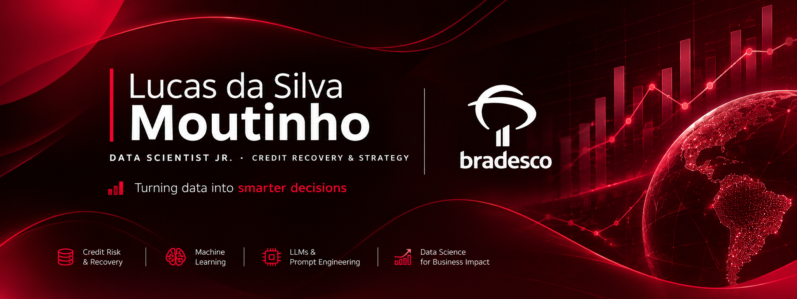

<!-- ═══════════════ HEADER ═══════════════ -->

  

   

  
  
  

    

  

  
  

    

  🌎 &nbsp;·&nbsp; 🇺🇸 English &nbsp;·&nbsp; 🇧🇷 Português

 

<!-- ═══════════════ SOBRE / ABOUT ═══════════════ -->

## 👨🏽‍💻 About me · Sobre mim

> **"Raw data is just the beginning. What matters is the decision it makes possible."**
>
> *"Dados brutos são só o começo. O que importa é a decisão que eles permitem tomar."*

### 🇺🇸 English

Hi! I'm **Lucas da Silva Moutinho**, a Computer Science and Science & Technology student at **UFABC (Federal University of ABC, Brazil)**, currently working as a **Junior Data Scientist at Bradesco**, in the **Credit Recovery & Strategy** area.

My professional journey is strongly connected to the financial services industry, with experience in **Credit Risk, Credit Recovery, Machine Learning and predictive modeling**. Before joining Bradesco, I spent **1 year and 6 months at Itaú Unibanco**, working as a Data Science Intern, also in Credit Recovery.

I enjoy working across the entire data science lifecycle: understanding business challenges, exploring and preparing data, developing predictive models, and translating analytical results into insights that support strategic decision-making.

I'm also expanding my knowledge in **Large Language Models (LLMs), Prompt Engineering and AI-driven solutions**, exploring ways to improve data utilization, analytical processes and the value generated from existing datasets.

My goal is to combine solid Data Science foundations, financial domain knowledge and emerging AI technologies to build solutions that generate meaningful business impact.

### 🇧🇷 Português

Sou **Lucas da Silva Moutinho**, estudante de Ciência da Computação e Bacharelado em Ciência e Tecnologia na **UFABC (Universidade Federal do ABC)**, atualmente atuando como **Cientista de Dados Júnior no Bradesco**, na área de **Recuperação de Crédito & Estratégia**.

Minha trajetória profissional está fortemente conectada ao mercado financeiro, com experiência em **Credit Risk, Recuperação de Crédito, Machine Learning e modelagem preditiva**. Antes de ingressar no Bradesco, atuei durante **1 ano e 6 meses no Itaú Unibanco**, como estagiário de Ciência de Dados, também na área de Recuperação de Crédito.

Gosto de acompanhar todo o ciclo de desenvolvimento de soluções analíticas: compreender os desafios do negócio, explorar e preparar dados, desenvolver modelos preditivos e transformar resultados analíticos em informações relevantes para a tomada de decisões estratégicas.

Paralelamente, venho aprofundando meus conhecimentos em **Large Language Models (LLMs), Prompt Engineering e soluções baseadas em Inteligência Artificial**, explorando possibilidades de aprimorar a utilização dos dados disponíveis, otimizar processos analíticos e extrair ainda mais valor das informações existentes.

Meu objetivo é unir fundamentos sólidos de Ciência de Dados, conhecimento do mercado financeiro e novas tecnologias de IA para desenvolver soluções que gerem impacto real no negócio.

<table>
  <tr>
    <td width="50%" valign="top">
      <h4>🎓 Education · Formação</h4>
      B.Sc. Computer Science &amp; Science and Technology 
      Ciência da Computação · Ciência e Tecnologia 
      <b>Universidade Federal do ABC (UFABC), Brazil</b>
    </td>
    <td width="50%" valign="top">
      <h4>💼 Current role · Atuação atual</h4>
      Junior Data Scientist 
      Cientista de Dados Júnior 
      <b>Bradesco · Credit Recovery &amp; Strategy</b>
    </td>
  </tr>
  <tr>
    <td width="50%" valign="top">
      <h4>🔭 Professional Focus · Foco</h4>
      Credit Risk, Machine Learning, predictive modeling, LLMs and Prompt Engineering 
      Credit Risk, Machine Learning, modelagem preditiva, LLMs e Engenharia de Prompts
    </td>
    <td width="50%" valign="top">
      <h4>🚀 Previous experience · Experiência anterior</h4>
      Data Science Intern · 1 year and 6 months 
      Estagiário de Ciência de Dados · 1 ano e 6 meses 
      <b>Itaú Unibanco · Credit Recovery</b>
    </td>
  </tr>
</table>

 

<!-- ═══════════════ STACK ═══════════════ -->

## 🛠️ Tech Stack · Stack Tecnológica

 

<!-- ═══════════════ EXPERIÊNCIA ═══════════════ -->

## 💼 Experience · Experiência

<table>
  <tr>
    <td width="170" align="center">
        
      <b>Bradesco</b> 
      Junior Data Scientist 
      Credit Recovery &amp; Strategy
    </td>
    <td>
      <b>🇺🇸 English</b>
      <ul>
        <li>📊 Applying <b>Data Science and Machine Learning</b> to credit recovery and strategic business challenges.</li>
        <li>🤖 Developing analytical solutions and predictive models to support decision-making.</li>
        <li>🎯 Working with data-driven approaches to improve credit strategies and business processes.</li>
      </ul>
      <b>🇧🇷 Português</b>
      <ul>
        <li>📊 Aplicação de <b>Ciência de Dados e Machine Learning</b> em desafios estratégicos de recuperação de crédito.</li>
        <li>🤖 Desenvolvimento de soluções analíticas e modelos preditivos para apoiar a tomada de decisão.</li>
        <li>🎯 Utilização de abordagens orientadas por dados para aprimorar estratégias de crédito e processos de negócio.</li>
      </ul>
    </td>
  </tr>
  <tr>
    <td width="170" align="center">
        
      <b>Itaú Unibanco</b> 
      Data Science Intern 
      Credit Recovery 
      <b>1 year and 6 months</b>
    </td>
    <td>
      <b>🇺🇸 English</b>
      <ul>
        <li>🤖 Developed and applied <b>Machine Learning</b> models for credit recovery and payment propensity analysis.</li>
        <li>🗄️ Worked with large-scale datasets, feature engineering and predictive modeling.</li>
        <li>📈 Evaluated model performance using statistical and business-oriented metrics.</li>
        <li>⚙️ Collaborated with credit policy and business teams to align analytical solutions with strategic objectives.</li>
      </ul>
      <b>🇧🇷 Português</b>
      <ul>
        <li>🤖 Desenvolvimento e aplicação de modelos de <b>Machine Learning</b> voltados à recuperação de crédito e análise de propensão de pagamento.</li>
        <li>🗄️ Manipulação de grandes volumes de dados, engenharia de atributos e modelagem preditiva.</li>
        <li>📈 Avaliação de performance de modelos utilizando métricas estatísticas e indicadores de negócio.</li>
        <li>⚙️ Colaboração com as áreas de políticas de crédito e negócio para alinhar soluções analíticas aos objetivos estratégicos.</li>
      </ul>
    </td>
  </tr>
</table>

 

<!-- ═══════════════ FOCO PROFISSIONAL ═══════════════ -->

## 🔭 Professional Focus · Focos de Atuação

🇺🇸 **English**

- **Credit Risk & Credit Recovery:** Predictive modeling, credit strategies and risk analytics.
- **Machine Learning:** Classification, model evaluation, feature engineering and optimization.
- **LLMs & Prompt Engineering:** Exploring LLM applications, prompt optimization and AI-driven analytical workflows.
- **Data Science:** Applied statistics, data analysis and business-oriented solutions.

🇧🇷 **Português**

- **Credit Risk & Recuperação de Crédito:** Modelagem preditiva, estratégias de crédito e análise de risco.
- **Machine Learning:** Classificação, avaliação de modelos, engenharia de atributos e otimização.
- **LLMs & Prompt Engineering:** Exploração de aplicações com LLMs, otimização de prompts e fluxos analíticos apoiados por IA.
- **Ciência de Dados:** Estatística aplicada, análise de dados e soluções orientadas ao negócio.

 

<!-- ═══════════════ CERTIFICAÇÕES ═══════════════ -->

## 🏆 Certifications & Badges · Certificações

<table>
  <tr>
    <td align="center" width="190">
       
      <b>Associate</b> Data Science
    </td>
    <td align="center" width="190">
       
      <b>Associate</b> Data Modelling
    </td>
    <td align="center" width="190">
       
      <b>Practitioner</b> D&amp;A Foundation
    </td>
    <td align="center" width="190">
       
      <b>Trained</b> Credit · Crédito
    </td>
    <td align="center" width="190">
       
      <b>Trained</b> Recovery · Recuperação
    </td>
  </tr>
</table>

🔗 Digital badges issued by <b>Itaú Unibanco</b>, verifiable on <a href="https://www.credly.com/users/lucas-moutinho">Credly</a> — click each one to validate. Badges digitais emitidos pelo <b>Itaú Unibanco</b> e verificáveis na Credly — clique para validar.

 

<!-- ═══════════════ ESTATÍSTICAS ═══════════════ -->

## 📊 GitHub Stats

 

<!-- ═══════════════ CONECTAR ═══════════════ -->

## 📫 Let's Connect · Vamos Conectar?

🇺🇸 Always open to exchanging ideas about **Data Science, Machine Learning, Credit Risk, financial services, LLMs and emerging AI technologies**.

🇧🇷 Aberto a trocar conhecimentos e experiências sobre **Ciência de Dados, Machine Learning, Credit Risk, mercado financeiro, LLMs e novas aplicações de Inteligência Artificial**.

 

  

